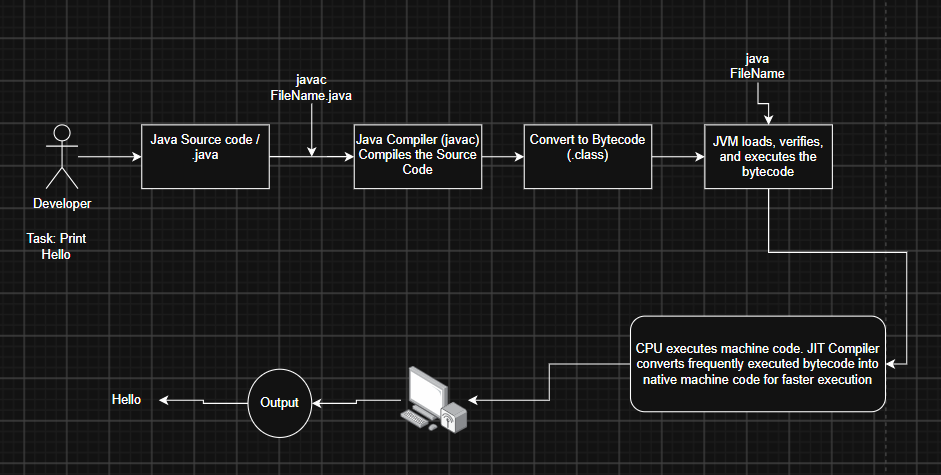
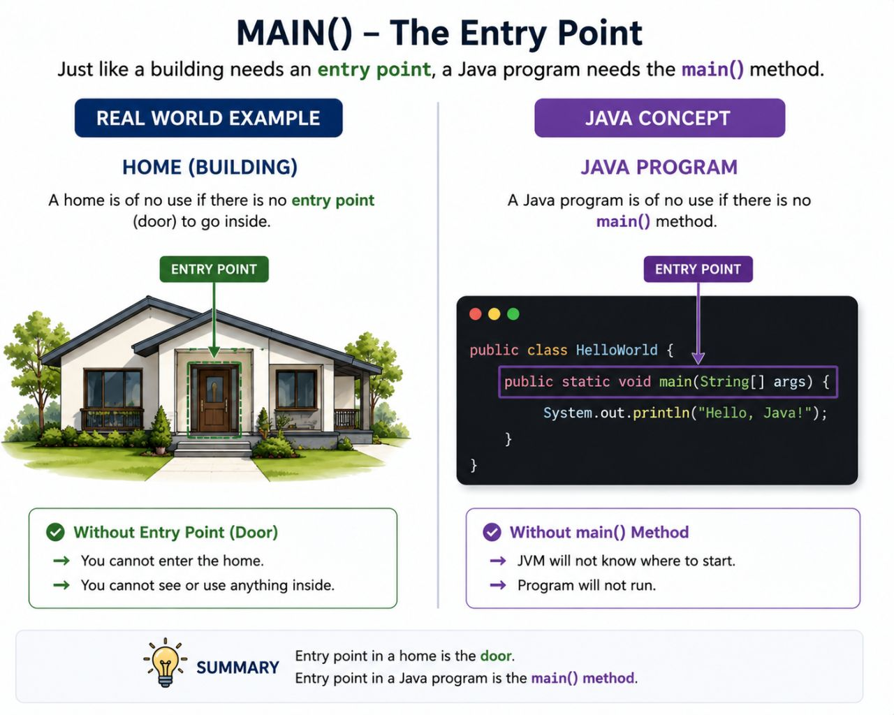

# 📘 My Java Backend Learning Journey

Hi! This repository is my daily learning log while I learn **Java** and backend development, under the mentorship of [Suresh Bishnoi](https://www.linkedin.com/in/bishnoisuresh/) Sir.

---

## 🗓️ Day 1 – Java Basics

I learned why Java is used so widely in the industry:

| Feature | What it means (in simple words) |
|---|---|
| ✅ Platform Independent | Java code runs on any OS (Windows, Mac, Linux) without changes, because of the JVM. |
| ✅ Object Oriented (OOPs) | We build programs using "objects" (like real-world things), which keeps code organized and reusable. |
| ✅ Automatic Garbage Collection | Java automatically removes unused objects from memory. We don't have to clean up manually. |
| ✅ Secure | Java doesn't allow direct memory access, which lowers the risk of harmful code. |
| ✅ JIT Compilation | The Just-In-Time compiler converts bytecode to machine code at run time, making programs faster. |
| ✅ Free to Use | Anyone can download and use Java without paying, which is why it's so widely adopted. |

I also wrote and successfully **compiled my first Java program**. Our instructor also told us to use **draw.io** to make architecture diagrams for every topic. This is helping me a lot — I understand concepts by *seeing* the flow, not just reading about it.

---

## 🗓️ Day 2 – How Java Works Internally

Today I learned the **full execution flow** of a Java program:

```
Java Source Code → Compiler → Bytecode → JVM → Output
```



I also practiced some basic rules:
- Every statement in Java ends with a **semicolon `;`**
- Java is **case-sensitive** (`Main` and `main` are different)

I solved some practice questions to make sure I understood these rules properly, and I made my own version of this diagram in draw.io.

I'm also uploading all my practice code to GitHub every day to stay consistent — something I already built as a habit during my JavaScript days, and now I'm carrying it into this Java/backend journey.

---

## 🗓️ Day 3 – Structure and Flow of a Java Program

Today I focused on understanding the **basic structure** of a Java program, especially the `main()` method.

### 🚪 The "Entry Point" Idea
Just like a house needs a door to enter, a Java program needs the **`main()`** method as the entry point — this is where the JVM starts running the code.



### 🛠️ Basic Development Flow
```
Requirement Understanding → Design → Development → Build (Compile) → Execute / Run & Test
```

As a practice example, I created an **`Account`** class to represent customer details (like in an SBI Net Banking example) and printed that information using Java.

### 🔑 New Concepts I Learned Today
- `public`, `private`, and `default` (access modifiers — who can use the code)
- **Identifiers** (the names we give to classes, methods, variables)
- `static` keyword (belongs to the class, not to a single object)
- `void` (method that doesn't return any value)
- `main()` (the entry point method)
- `String[] args` (used to pass values into the program from outside)

I wrote a small program combining all these concepts together, instead of just reading the theory — this made it much easier to understand.

---

# [How Java Memory Works with Primitive and Non-Primitive Types](Java%20Memory%20%28Stack%20Or%20Heap%29/README.md)
# [Static vs Dynamic](static-vs-dynamic/static.md)
# [Understanding of JIT and Interpreter with full Architecture](Understanding%20Of%20JIT/README.md)
---
# [Day 4 Command-Line Arguments](Day%204/Day4-Java-Command-Line.md)

---
# Java Data Types

Today I learned about **Data Types**, their **range**, **bits**, **bytes**, **default values**, **local variables**, **class/static variables**, and **wrapper classes** in Java.

---

## 1. What is a Data Type?

A **data type** tells Java what type of value a variable can store.

Example:

```java
int age = 20;
```

- `int` → Data Type
- `age` → Variable
- `20` → Value

Simple definition:

> **Data type means the type of data that a variable can store.**

---

## 2. Java Primitive Data Types

Java has **8 primitive data types**:

```text
byte
short
int
long
float
double
char
boolean
```

### Data Type, Bits, Bytes and Range

| Data Type | Bits | Bytes | Range / Values | Default Value |
|---|---:|---:|---|---|
| `byte` | 8 | 1 | -128 to 127 | `0` |
| `short` | 16 | 2 | -32,768 to 32,767 | `0` |
| `int` | 32 | 4 | -2³¹ to 2³¹ - 1 | `0` |
| `long` | 64 | 8 | -2⁶³ to 2⁶³ - 1 | `0` |
| `float` | 32 | 4 | Decimal numbers | `0.0f` |
| `double` | 64 | 8 | Decimal numbers | `0.0d` |
| `char` | 16 | 2 | 0 to 65,535 | `\u0000` |
| `boolean` | Not fixed by Java | JVM-dependent | `true` / `false` | `false` |

### Easy way to remember

```text
byte    →  8 bits  → 1 byte
short   → 16 bits  → 2 bytes
int     → 32 bits  → 4 bytes
long    → 64 bits  → 8 bytes

float   → 32 bits  → 4 bytes
double  → 64 bits  → 8 bytes

char    → 16 bits  → 2 bytes
boolean → true / false
```

---

## 3. byte Range Example

The range of `byte` is:

```text
-128 to 127
```

This is valid:

```java
byte amount = 127;
System.out.println(amount);
```

Output:

```text
127
```

But this is not valid:

```java
byte amount = 128;
```

Because `128` is outside the `byte` range.

Java gives an error such as:

```text
incompatible types: possible lossy conversion from int to byte
```

---

## 4. Class/Static Variable

In simple language, we can call a variable declared outside a method a **global variable**.

But in proper Java terminology, it is better to call it a **class variable/field**.

If it has `static`, it is called a **static variable**.

Example:

```java
public class DataType
{
    static int number;

    public static void main(String args[])
    {
        System.out.println(number);
    }
}
```

Output:

```text
0
```

Why?

Because Java automatically gives a default value to a class/static variable.

For example:

```text
int     → 0
float   → 0.0f
double  → 0.0d
boolean → false
char    → \u0000
```

---

## 5. Local Variable

A local variable is declared inside a method, constructor, or block.

Example:

```java
public class DataType
{
    public static void main(String args[])
    {
        short number = 2000;

        System.out.println(number);
    }
}
```

Output:

```text
2000
```

### Important Point

Local variables **do not get default values**.

Example:

```java
public class DataType
{
    public static void main(String args[])
    {
        short number;

        System.out.println(number);
    }
}
```

This gives an error:

```text
variable number might not have been initialized
```

So:

```text
Class/Static Variable → gets default value
Local Variable        → must be initialized before use
```

---

## 6. Wrapper Classes

A **wrapper class** is a class that represents a primitive data type as an object.

### Primitive → Wrapper Class

```text
byte    → Byte
short   → Short
int     → Integer
long    → Long
float   → Float
double  → Double
char    → Character
boolean → Boolean
```

### Simple Example

```java
public class DataType
{
    public static void main(String args[])
    {
        // Primitive data type
        int num = 45;

        System.out.println(num);

        // Wrapper class
        Integer num30 = 45;

        System.out.println(num30);
    }
}
```

Output:

```text
45
45
```

Here:

```text
int     → primitive data type
Integer → wrapper class
```

---

## 7. Float and Integer Example

```java
public class DataType
{
    public static void main(String args[])
    {
        // Primitive
        float price = 667.0f;
        System.out.println(price);

        // Wrapper class
        Float num45 = 667.0f;
        System.out.println(num45);

        // Primitive
        int num = 45;
        System.out.println(num);

        // Wrapper class
        Integer num30 = 45;
        System.out.println(num30);
    }
}
```

Output:

```text
667.0
667.0
45
45
```

Remember:

```text
float   → primitive
Float   → wrapper class

int     → primitive
Integer → wrapper class
```

---

## 8. Autoboxing and Unboxing

Java can automatically convert between primitive values and wrapper objects.

### Autoboxing

Primitive → Wrapper object

```java
int num = 45;
Integer number = num;
```

This is called **autoboxing**.

### Unboxing

Wrapper object → Primitive

```java
Integer number = 45;
int num = number;
```

This is called **unboxing**.

---

# Today's Important Points

- **Data type** tells Java what type of value a variable can store.
- Java has **8 primitive data types**.
- `byte`, `short`, `int`, and `long` store whole numbers.
- `float` and `double` store decimal numbers.
- `char` stores a single character.
- `boolean` stores `true` or `false`.
- `byte` range is **-128 to 127**.
- Class/static variables get **default values automatically**.
- Local variables **do not get default values**.
- A local variable must be initialized before we use it.
- `Integer` is a wrapper class for `int`.
- `Float` is a wrapper class for `float`.
- Primitive → Wrapper is called **autoboxing**.
- Wrapper → Primitive is called **unboxing**.

---

# Java Variables 

## What is a variable?

Variable is a container to hold some information.

Example: create a variable and give it a value.

```
int balance = 200;
```

Here `balance` is name of container, `int` is type, `200` is value stored in it.

---

## Three types of variable

There are three type of variable in Java:

1. Instance variable
2. Static variable
3. Local variable

Small diagram to remember:

```
        VARIABLE
           |
   --------------------
   |         |        |
Instance   Static   Local
(object)   (class)  (method/block)
```

---

## 1. Instance Variable

- Belongs to object, not to class.
- Every object create his own copy of it.
- Think of it as schema (design) of every object created by that class. Each object fill that schema with its own value.

Example:

```java
class Account
{
    // Instance variable
    String name = "Sudarshan Patil";
    int accountBalance = 2500;
}
```

Diagram:

```
class Account (schema: name, accountBalance)

  acc1 --> name="Ram"    balance=1000
  acc2 --> name="Sita"   balance=2500
  acc3 --> name="Sudarshan" balance=2500
```

Each object (acc1, acc2, acc3...) has its own copy. Changing one object's value does not affect other object.

**Why we need instance variable:**
Suppose bank has 1000 users. Every user has common identity like name, age, accountBalance. If we don't use class/object concept and try to make 1000 x 3 separate variables manually, it will take too much effort and space. Instead we write the variable once inside class (as instance variable), and every object created from that class automatically gets its own copy. We write once, use many times, each with its own value.

To access instance variable, we must first create an object:

```java
Account acc = new Account();
System.out.println(acc.name);
System.out.println(acc.accountBalance);
```

---

## 2. Static Variable

- Belongs to class, not to object.
- Shared by entire class, but used within the boundary of that class.
- Same value is accessed by everyone, no separate copy for each object.

Example:

```java
class Account
{
    static int interest = 3;
    static int productAmount = 200;
}
```

Diagram:

```
class Account
   static interest = 3%   <-- only ONE copy exists

acc1 --> uses interest (3%)
acc2 --> uses interest (3%)
acc3 --> uses interest (3%)
```

**Why we need static variable:**
Bank gives same rate of interest to every account, like 3%. We don't want every object to have its own separate copy of interest, because it is common for all. So we define it once as static, and every object/class use the same value.

Access static variable directly with class name (no need to create object):

```java
System.out.println(Account.interest);
```

Also static method can be called without object:

```java
Account.doSomething(); // no need "new Account()" 
```

But non-static (instance) method needs an object:

```java
Account acc = new Account();
acc.doNothing(); // need object to call
```

---

## 3. Local Variable

- Declared inside a method or block.
- Only accessible inside that method/block. Cannot be used outside it.

Example:

```java
public static void main(String args[])
{
    int amount = 100; // local variable, only for main method
    System.out.println(amount);
}
```

If we try to use this local variable in another method, it will give error, because scope of local variable ends with that method/block.

```java
static void localCheck(){
    // System.out.println(amount); // ERROR - cannot find symbol
    // "amount" was declared inside main(), not visible here
}
```

Diagram:

```
main()  { int amount = 100;  }   <-- amount lives only here
                 |
                 X   (not visible outside)
                 |
localCheck() { }   <-- cannot see "amount"
```

**Important point:** Java forces us to initialize local variable before use. If we don't give value to local variable and try to use it, compiler will give error. This is different from instance/static variable, which get default value automatically (like 0, null, false) even if we don't assign anything.

---

## Quick comparison table

| Type     | Belongs to | Copy per object? | Default value if not set | Access without object? |
|----------|-----------|-------------------|---------------------------|--------------------------|
| Instance | Object    | Yes, each object gets own copy | Yes (auto) | No, need object |
| Static   | Class     | No, one copy shared by all | Yes (auto) | Yes, ClassName.variable |
| Local    | Method/Block | N/A, exists only during method call | No, must initialize manually | N/A, only inside method |

---

## One more example - calling static method from main

```java
public static void main(String args[])
{
    doSomething();          // works because main() itself is static,
                             // and belongs to same class, so no object needed

    Account.doSomething();  // this is more clear way - ClassName.methodName()
                             // since method is static, we call using class name

    acc.doNothing();        // doNothing() is NOT static
                             // so we must create object first: Account acc = new Account();
}
```

Simple rule to remember:

```
static method/variable   -->  call using ClassName
instance method/variable -->  call using object (new ClassName())
```
---
# Java Methods

Simple notes from the Java session, with the unrelated classroom conversation removed.

## 1. What is a Method?

A **method** is a block of code used to perform a specific task.

```java
void printMessage() {
    System.out.println("Hello");
}
```

### Why use methods?

- Organize code
- Reuse code
- Keep `main()` simple
- Perform a specific task

> Write the logic inside methods instead of putting everything inside `main()`.

---

## 2. Basic Method Structure

```java
returnType methodName(parameters) {

    // logic

    return value;
}
```

Example:

```java
boolean doTransaction(int amount,
                      String senderAccount,
                      String receiverAccount) {

    // business logic

    return true;
}
```

### Parts of a Method

```text
boolean              → return type
doTransaction        → method name
int amount           → parameter
String senderAccount → parameter
String receiverAccount → parameter
{ }                  → method body
return true          → return value
```

---

## 3. Parameters

**Parameters** are inputs received by a method.

```java
int add(int a, int b) {
    return a + b;
}
```

Here:

```text
a and b → parameters
```

When calling the method:

```java
add(10, 20);
```

`10` and `20` are the values passed to the method.

---

## 4. Return Type

The return type tells what type of value the method returns.

### `int`

```java
int add(int a, int b) {
    return a + b;
}
```

### `boolean`

```java
boolean isValid(int age) {
    return age >= 18;
}
```

### `void`

If the method does not return a value:

```java
void printMessage() {
    System.out.println("Hello");
}
```

---

## 5. Calling a Method

### Static Method

A `static` method belongs to the class.

Call it using the class name:

```java
ClassName.methodName();
```

Example:

```java
MathOperations.add(10, 20);
```

### Non-Static Method

A non-static method belongs to an object.

Create an object first:

```java
MathOperations obj = new MathOperations();

obj.add(10, 20);
```

Remember:

```text
static     → class
non-static → object
```

---

## 6. Method Reusability

A major benefit of methods is **code reuse**.

Instead of writing the same logic 100 times:

```text
Write method once
      ↓
Call it many times
```

Example:

```java
int add(int a, int b) {
    return a + b;
}
```

Call it multiple times:

```java
add(10, 20);
add(30, 40);
add(50, 60);
```

The same method is reused with different inputs.

---

## 7. Method Execution Flow

Java starts execution from `main()`.

```text
main()
  ↓
calls method
  ↓
control goes to method
  ↓
method executes
  ↓
return value
  ↓
control comes back to caller
```

Example:

```java
public static void main(String[] args) {

    boolean result = doTransaction(100, "A101", "B202");

    System.out.println(result);
}
```

---

## 8. Example: Fund Transfer

A fund-transfer method may require:

```text
Amount
Sender Account
Receiver Account
```

Example:

```java
boolean doTransaction(int amount,
                      String senderAccount,
                      String receiverAccount) {

    // debit sender
    // credit receiver

    return true;
}
```

Basic idea:

```text
Sender balance = 100
Receiver balance = 200
Transfer      = 10

Sender   → 90
Receiver → 210
```

Total money remains:

```text
90 + 210 = 300
```

---

## 9. Method Types

### Inbuilt Methods

Methods already provided by Java/classes.

Examples:

```java
System.out.println();
Integer.parseInt();
```

### User-Defined Methods

Methods created by the developer.

```java
int add(int a, int b) {
    return a + b;
}
```

---

## 10. Naming Convention

Use **camelCase** for method and variable names.

Correct:

```java
doTransaction();
calculateAmount();
addNumbers();
```

Avoid:

```java
DoTransaction();
calculate_amount();
ADDNUMBERS();
```

Use meaningful names that describe what the method does.

---

## 11. Single Responsibility Principle

A class should have **one main responsibility**.

Example:

```text
FundTransfer
    ↓
Fund transfer functionality
```

Do not mix unrelated functionality into the same class:

```text
Fund transfer
+ Add beneficiary
+ Send SMS
+ Open fixed deposit
+ Notifications
```

Keep related functionality together.

### Simple Rule

```text
One class → One main responsibility
```

---

# Quick Revision

```text
Method
→ Block of code that performs a task

Parameter
→ Input received by method

Return type
→ Type of value returned

void
→ No return value

static
→ Called using class

non-static
→ Called using object

Method reuse
→ Write once, call many times

main()
→ Starting point of program

User-defined method
→ Created by developer

Inbuilt method
→ Already provided by Java

camelCase
→ Method and variable naming convention

Single Responsibility
→ One class should have one main responsibility
```

## Practice

Create methods for:

1. Add two numbers
2. Subtract two numbers
3. Calculate discount
4. Check whether a number is even
5. Calculate fund transfer
6. Return `true` / `false` based on a condition

---

# Java Constructors & Inheritance

Simple notes from today's Java session.  
Only the important technical concepts are included.

---

## 1. Constructor

A **constructor** is used to initialize an object.

### Rules

- Constructor name must be the same as the class name.
- It has **no return type**.
- It runs when an object is created.

```java
class User {

    String name;
    String country;

    User(String name, String country) {
        this.name = name;
        this.country = country;
    }
}
```

---

## 2. Default Constructor

A constructor without parameters:

```java
User() {
}
```

If no constructor is written at all, Java can provide a default constructor automatically.

If you create your own parameterized constructor, Java does **not** automatically provide the no-argument constructor.

---

## 3. Parameterized Constructor

A constructor that receives values:

```java
User(String name, String country) {
    this.name = name;
    this.country = country;
}
```

Object creation:

```java
User u = new User("Sudarshan", "India");
```

---

## 4. `this`

`this` refers to the **current object**.

```java
this.name = name;
```

Here:

```text
this.name → instance variable
name      → constructor parameter
```

---

## 5. `this()`

`this()` calls another constructor of the **same class**.

```java
class User {

    String name;
    int age;

    User() {
        this("Sudarshan", 27);
    }

    User(String name, int age) {
        this.name = name;
        this.age = age;
    }
}
```

### Flow

```text
User()
  ↓
this("Sudarshan", 27)
  ↓
User(String, int)
```

### Rule

`this()` must be the **first statement** inside the constructor.

---

## 6. Inheritance

Inheritance allows a child class to inherit from a parent class.

```java
class Product {
}

class ElectronicProduct extends Product {
}
```

```text
Product
   ↑
ElectronicProduct
```

`extends` creates the parent-child relationship.

---

## 7. `super()`

`super()` calls the constructor of the **parent class**.

```java
class Product {

    Product(String name, int price, String productId) {
        // initialize common fields
    }
}

class ElectronicProduct extends Product {

    ElectronicProduct(String name, int price, String productId) {
        super(name, price, productId);
    }
}
```

### Remember

```text
this()  → same class constructor
super() → parent class constructor
```

`super()` is used for **constructor chaining** and reusing parent initialization.

---

## 8. Common + Specific Fields

A parent class should contain fields common to all products.

```text
Product
├── name
├── price
└── productId
```

A child class can contain fields specific to its type.

```text
ElectronicProduct
└── warranty
```

Example:

```java
class Product {

    String name;
    int price;
    String productId;

    Product(String name, int price, String productId) {
        this.name = name;
        this.price = price;
        this.productId = productId;
    }
}

class ElectronicProduct extends Product {

    String warranty;

    ElectronicProduct(String name, int price,
                      String productId, String warranty) {

        super(name, price, productId);
        this.warranty = warranty;
    }
}
```

### Benefit

`super()` avoids repeating the parent initialization code.

---

## 9. Constructor Chaining

**Constructor chaining** means one constructor calls another constructor.

```text
this()  → constructor in same class
super() → constructor in parent class
```

Important:

```text
this() / super()
      ↓
must be first statement
```

---

## 10. Constructor Cannot Update an Existing Object

A constructor is used when creating an object.

```java
Product p = new Product("Phone", 50000, "P001");
```

You do not call the constructor again on the same object to update it.

For updating an existing object, use a method/setter.

---

## 11. Calling a Parent Method

A child class inherits accessible methods from the parent.

```java
class Test {

    void printTest() {
        System.out.println("Hello");
    }
}

class Driver extends Test {
}
```

You can call:

```java
Driver d = new Driver();
d.printTest();
```

If you specifically want to call the **parent version** of a method:

```java
class Driver extends Test {

    void callParentMethod() {
        super.printTest();
    }
}
```

### Remember

```text
super()          → parent constructor
super.method()   → parent method
```

---

## 12. `Driver extends Test` Example

```java
class Test {

    String name;
    int age;

    Test(String name, int age) {
        this.name = name;
        this.age = age;
    }

    Test() {
        this("Sudarshan", 27);
    }

    void printTest() {
        System.out.println(name);
        System.out.println(age);
    }
}

class Driver extends Test {

    void callPrint() {
        super.printTest();
    }

    public static void main(String[] args) {
        Driver d = new Driver();
        d.callPrint();
    }
}
```

### Flow

```text
new Driver()
     ↓
parent constructor
     ↓
Test()
     ↓
this("Sudarshan", 27)
     ↓
Test(String, int)
     ↓
name and age initialized
     ↓
super.printTest()
     ↓
parent method executes
```

---

## 13. Java Comments / Documentation

Comments help other developers understand code without reading every line.

### Single-line comment

```java
// This creates a user object
```

### Multi-line comment

```java
/*
   This class represents a user.
*/
```

### JavaDoc

```java
/**
 * Represents a user in the application.
 */
class User {
}
```

JavaDoc is useful for documenting classes and methods.

---

# Quick Revision

```text
Constructor
→ Initialize object

this
→ Current object

this()
→ Same class constructor

extends
→ Inheritance

super()
→ Parent constructor

super.method()
→ Parent method

Constructor chaining
→ One constructor calls another

Parent class
→ Common fields / behavior

Child class
→ Specific fields / behavior
```

## Most Important

```text
this()  = SAME CLASS
super() = PARENT CLASS
```

---
# Java Constructors

This repository contains Java practice and notes on **Constructors, Constructor Chaining, `this()`, and `super()`**.

## Topics Covered

- What is a Constructor?
- Constructor creation and initialization
- `this()` constructor call
- `super()` constructor call
- Constructor Chaining
- `this` vs `super`
- Parent and Child classes
- Common and specific properties
- Practical use of `this()`
- Practical use of `super()`
- Constructor access modifiers
- Constructor vs object update

---

## 1. What is a Constructor?

A constructor is used to **create an object and initialize its state**.

### Rules

- Constructor name must be the same as the class name.
- Constructor does not have a return type.
- Constructor executes when an object is created.

```java
class Test {

    String name;
    int age;

    Test(String name, int age) {
        this.name = name;
        this.age = age;
    }
}
```

Creating an object:

```java
Test t = new Test("Sudarshan", 27);
```

---

## 2. `this()`

`this()` is used to call another constructor of the **same class**.

```java
class Test {

    String name;
    int age;

    Test() {
        this("Sudarshan", 27);
    }

    Test(String name, int age) {
        this.name = name;
        this.age = age;
    }
}
```

### Flow

```text
Test()
   ↓
this("Sudarshan", 27)
   ↓
Test(String, int)
```

---

## 3. `super()`

`super()` is used to call the constructor of the **parent class**.

```java
class Product {

    Product(String name, int price) {
        // parent constructor
    }
}

class ElectronicProduct extends Product {

    ElectronicProduct(String name, int price) {
        super(name, price);
    }
}
```

---

## 4. Constructor Chaining

Constructor chaining means:

> **One constructor calls another constructor.**

It can happen using:

```text
this()  → Same class constructor
super() → Parent class constructor
```

### Important Rule

`this()` or `super()` must be the **first statement** inside a constructor.

If neither is written, Java implicitly calls:

```java
super();
```

---

## 5. `this` vs `super`

| `this` | `super` |
|---|---|
| Current/Same class | Parent class |
| `this()` → same class constructor | `super()` → parent constructor |
| `this.name` → current object's variable | `super.name` → parent variable |

### Easy Memory

```text
this  → SAME
super → PARENT
```

---

## 6. Practical Use of `this()`

`this()` can be used to provide **default values** through another constructor.

```java
class User {

    String name;
    String country;

    User() {
        this("Guest", "India");
    }

    User(String name, String country) {
        this.name = name;
        this.country = country;
    }
}
```

Now:

```java
User user = new User();
```

The default values are initialized through constructor chaining.

---

## 7. Practical Use of `super()`

`super()` is useful when the parent class contains **common fields** and the child class contains **specific fields**.

### Parent Class

```java
class Product {

    String name;
    int price;
    String productId;

    Product(String name, int price, String productId) {
        this.name = name;
        this.price = price;
        this.productId = productId;
    }
}
```

### Child Class

```java
class ElectronicProduct extends Product {

    String warranty;

    ElectronicProduct(String name, int price,
                      String productId, String warranty) {

        super(name, price, productId);

        this.warranty = warranty;
    }
}
```

### Structure

```text
Product
├── name
├── price
└── productId
        ↓
ElectronicProduct
└── warranty
```

`super()` initializes the **common parent fields**, while the child constructor initializes its **specific field**.

### Main Benefit

> Avoids duplicate initialization code.

---

## 8. Common vs Specific Properties

Different product types can have different properties.

### Electronic Product

```text
name
price
productId
warranty
```

### Clothing Product

```text
name
price
productId
size
color
```

The common properties can be kept in the parent `Product` class, while specific properties can be kept in child classes.

---

## 9. Constructor is Not Used for Updating

A constructor is used when **creating an object**.

```java
Product p = new Product("Phone", 50000);
```

To update an existing object, use a method/setter instead of trying to call the constructor again.

---

## 10. Constructor Access Modifiers

Constructors follow the same access rules as other class members.

| Modifier | Access |
|---|---|
| `public` | Anywhere |
| `default` | Same package |
| `private` | Same class |
| `protected` | Same package + subclasses |

Example:

```java
public Product() {
}
```

A `public` constructor can be accessed from outside the package.

A default constructor is accessible within the same package.

---

## 11. Quick Revision

```text
Constructor
    ↓
Create + Initialize Object

this()
    ↓
Same Class Constructor

super()
    ↓
Parent Class Constructor

Constructor Chaining
    ↓
One Constructor → Another Constructor

this  = SAME
super = PARENT
```

---

## 12. Interview Question

### What is the difference between `this()` and `super()`?

**Answer:**

`this()` is used to call another constructor of the same class, whereas `super()` is used to call the constructor of the parent class.

---

## Practice

Try creating similar examples using:

- `Netflix User`
- `E-commerce Product`
- `Electronic Product`
- `Clothing Product`
- Another application/domain of your choice

The goal is to understand **why** `this()` and `super()` are used, not just memorize the syntax.

---

## Repository Structure

```text
java-constructors/
│
├── README.md
│
└── src/
    └── com/
        └── constructor/
            ├── Test.java
            ├── Driver.java
            ├── Product.java
            └── ElectronicProduct.java
```

---

## Key Takeaway

```text
this()  → Call constructor in SAME class
super() → Call constructor in PARENT class
```

**Constructor Chaining = Calling one constructor from another constructor.**


---
⭐ *Consistency over perfection — one concept, one day at a time.*
